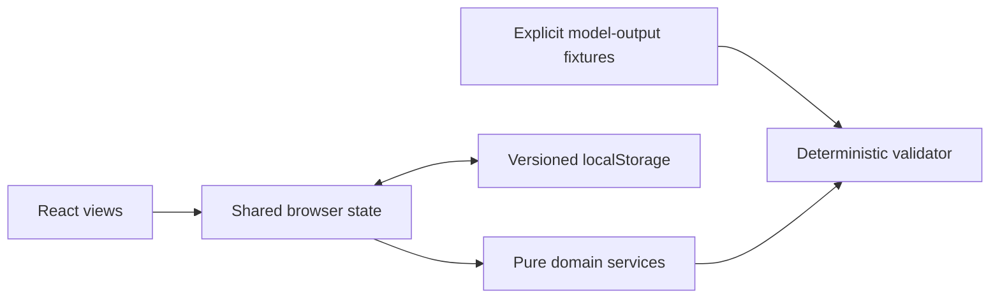

# Architecture

The application is a static Next.js App Router export. A client application owns navigation and selection; versioned browser state owns all records. Pure domain services own money calculations, lifecycle guards, and recommendation validation. No API keys, model calls, or runtime server are used.

Money uses integer cents; quotes use basis points (10000 = 100%). Lifecycle transitions are sequential and guard documentation. Audit events include previous/new state, timestamp and context. Corrupt storage falls back to deterministic seeds. A future Go API can implement the same domain contracts and replace the store's persistence adapter with authenticated requests and transactional database writes.

## Implementation plan
1. Establish contracts and deterministic domain services.
2. Implement connected CRM, loan progression, marketplace and guardrail views.
3. Integrate versioned persistence and guided navigation.
4. Verify unit and browser workflows, then produce a static Pages build.
5. Document and publish if authenticated repository access is available.
