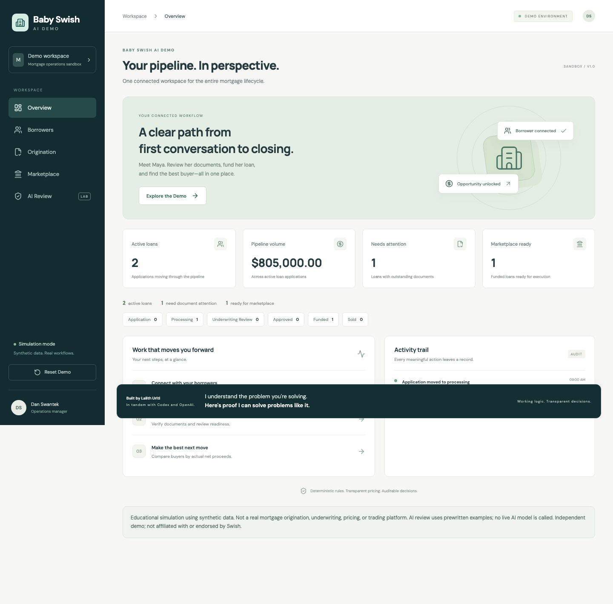
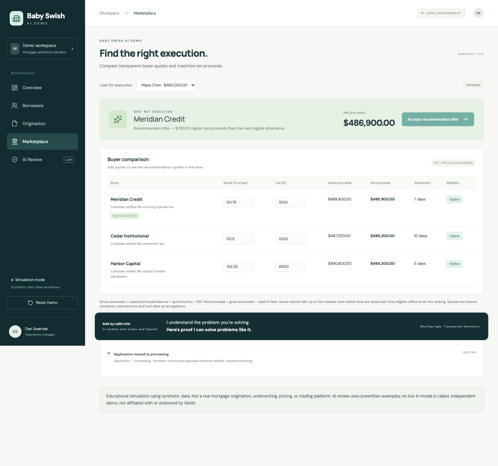

# Baby Swish AI Demo

**A mortgage operations simulator exploring the boundary between AI-assisted recommendations and deterministic financial workflows.**

Follow a fictional mortgage from borrower relationship management through origination, funding, investor offer comparison, and simulated sale. Then inspect flawed model-output fixtures with executable validation rules.

**Educational simulation using synthetic data. Not a real mortgage origination, underwriting, pricing, or trading platform.**

Publication mode: generated static files are published from the `gh-pages` branch (root). The custom Actions deployment stalled in `updating_pages`, so publication was switched to GitHub’s branch-based Pages deployment. The public URL was verified with HTTP 200, correct final footer, working loan progression, and no runtime or asset errors. The main-branch workflow verifies the source and produces a static artifact without deploying.

Verified live demo: [Baby Swish AI Demo](https://lalithu.github.io/mortgage-ops-lab/). Deployment status is recorded in [GitHub Actions](https://github.com/lalithu/mortgage-ops-lab/actions).





## Product

- Overview metrics derived from shared borrower and loan state.
- Searchable borrower records, editable notes, lead status, and application creation.
- A sequential origination workflow with required-document guards and an audit trail.
- Three fictional investors with transparent price, fee, and settlement assumptions.
- Highest-net-proceeds recommendations that can differ from highest quoted price.
- AI-output fixtures validated against deterministic pricing and workflow invariants.
- Versioned browser persistence, guided exploration, and deterministic demo reset.

All activity is simulated in the browser. AI Review uses prewritten examples; it does not call a live language model. No sign-in, database, runtime server, secrets, or external financial services are required.

## Architecture

Next.js App Router, React, strict TypeScript, Tailwind CSS, and Lucide icons form the interface. Pure TypeScript domain services calculate money and enforce lifecycle rules. A shared client store connects all five views and persists progress in localStorage. See [ARCHITECTURE.md](ARCHITECTURE.md) for boundaries and a future Go service migration path.

Money is represented as integer cents. Quotes use basis points, where 10,000 means 100% of principal. Gross proceeds are rounded to the nearest cent before explicit fees are deducted. Recommendations rank eligible offers by net proceeds without unexplained risk adjustments.

For Maya's seeded $480,000 loan, Harbor Capital quotes 102.25% but charges $6,500, yielding $484,300 net. Meridian Credit quotes 101.75% with a $1,500 fee, yielding $486,900 net. Cedar Institutional yields $486,200 after its $1,000 fee. Meridian wins by $700 over the next eligible alternative.

## Run locally

Use Node.js 22 and npm:

```sh
npm ci
npm run dev
```

Open http://localhost:3000. Browser progress persists across refreshes. Use **Reset Demo** to restore the seeded scenario.

## Verify

```sh
npm run typecheck
npm test
npx playwright install chromium
npm run test:e2e
npm run build
```

Vitest covers domain invariants; Playwright covers the connected browser workflow, persistence, reset, and basic responsive accessibility checks. Browser installation is required once per environment. The CI workflow installs Chromium and runs checks before producing the deployment artifact. Test presence alone is not a claim that a particular environment has passed; consult the engineering log and CI results for recorded runs.

## Deploy to GitHub Pages

1. Create a public repository named `mortgage-ops-lab` and push this project, including its lockfile, to `main`.
2. In repository **Settings → Pages**, select **Deploy from a branch**, then `gh-pages` and `/ (root)`.
3. Build with `PAGES_BUILD=1 npm run build`. Publish the contents of `out/`, including `.nojekyll`, to `gh-pages`. Main-branch pushes run verification only.
4. Confirm the deployment job succeeds, then open and inspect the resulting Pages URL.

The workflow runs `PAGES_BUILD=1 npm run build`, exports to `out/`, adds `.nojekyll`, and uploads that directory. This uses `/mortgage-ops-lab` as the base path; local builds use the root path. Next.js image optimization is disabled and trailing slashes are enabled for static hosting. A differently named repository requires updating the base path in `next.config.ts`. No Next.js server is needed in production.

## Engineering process

This project was developed with AI assistance and real workstream delegation. Domain rules, UI implementation, and delivery documentation were assigned separate ownership boundaries and integrated by a coordinator. [ENGINEERING_LOG.md](ENGINEERING_LOG.md) records actual decisions, corrections, and verification. [DEMO_SCRIPT.md](DEMO_SCRIPT.md) provides a 90-second walkthrough.

## Limits and future work

The underwriting rules and investor offers are deliberately simplified demonstrations. localStorage provides single-browser persistence, without authentication, multi-user collaboration, durable server audit storage, or transaction guarantees. A future service could replace browser persistence with authenticated Go APIs and a database while retaining typed contracts and deterministic validation. Live model integration would require server-side credentials, input controls, and validation before any consequential action. The project is independent and is not affiliated with or endorsed by Swish or any financial institution.

## Visitor tracking

A tiny, cookie-free background request records page loads through a Supabase Edge Function. Records are private, with no public table policies or frontend secret keys. See [Supabase setup and visit queries](supabase/README.md). The live page-load and refresh requests were verified with successful 204 responses; visits can be viewed in the project's Table Editor.
